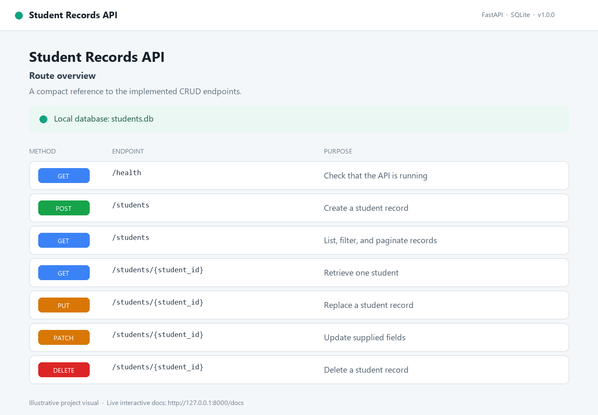
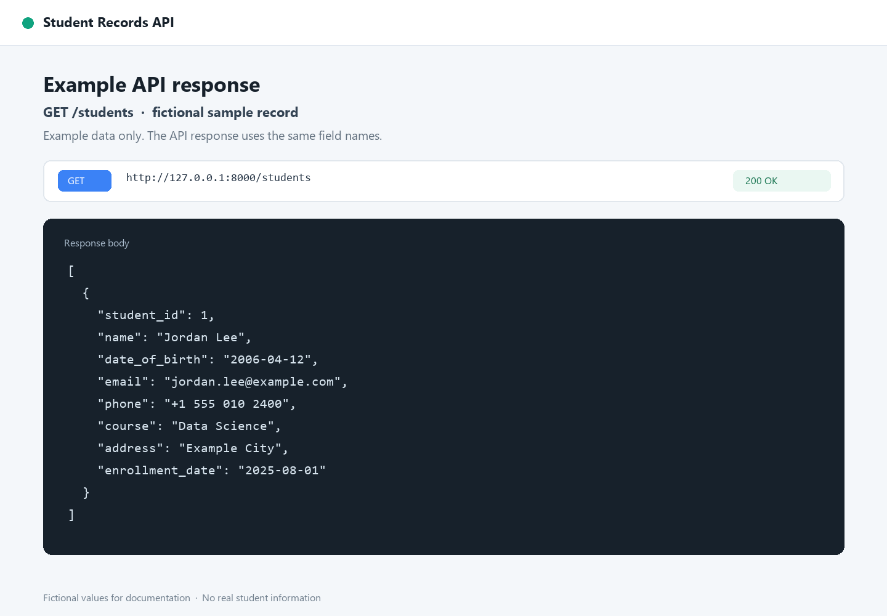

# Student Records API

A small student database application built for the EWB Edu Tech internship assignment. It uses FastAPI for the HTTP API and SQLite for persistent storage. The project uses only fictional sample records; do not enter real student personal information into a public demo.

## Requirements

- Python 3.10 or later
- pip

## Install and run

From this folder, create and activate a virtual environment, then install the dependencies:

```powershell
py -m venv .venv
.venv\Scripts\Activate.ps1
python -m pip install -r requirements.txt
```

Start the development server:

```powershell
python -m uvicorn main:app --reload
```

The API is available at `http://127.0.0.1:8000`. Interactive API documentation is at `http://127.0.0.1:8000/docs`.

On first startup, the application creates `students.db` in the current directory and creates its table if needed. To use another database file, set `STUDENTS_DB_PATH` before starting the server:

```powershell
$env:STUDENTS_DB_PATH = "./data/students.db"
python -m uvicorn main:app --reload
```

## Endpoints

| Method | Path | Description |
| --- | --- | --- |
| `GET` | `/health` | Check that the API is running |
| `POST` | `/students` | Create a student |
| `GET` | `/students` | List students; optional filters and pagination |
| `GET` | `/students/{student_id}` | Get one student |
| `PUT` | `/students/{student_id}` | Replace all student fields |
| `PATCH` | `/students/{student_id}` | Update only supplied fields |
| `DELETE` | `/students/{student_id}` | Delete a student |

Student records have a generated integer `student_id`, required `name` and ISO-format `date_of_birth`, and at least one of `email` or `phone`. `course`, `address`, and `enrollment_date` are optional. Unknown request fields are rejected. Dates must use `YYYY-MM-DD`; future birth dates and enrollment dates before birth dates are rejected. Missing IDs return `404`.

The list endpoint accepts `name` and `course` substring filters (case-insensitive), `born_after`, `born_before`, `limit` (1–100, default 100), and `offset` (default 0). Birth date bounds are exclusive.

## Screenshots

These illustrative project visuals summarize the API routes and a fictional list response. Run the server and open `/docs` for the interactive FastAPI documentation.





## Try it with PowerShell

Create a fictional record:

```powershell
$student = @{
  name = "Jordan Lee"
  date_of_birth = "2006-04-12"
  email = "jordan.lee@example.com"
  phone = "+1 555 010 2400"
  course = "Data Science"
  address = "Example City"
  enrollment_date = "2025-08-01"
} | ConvertTo-Json

$created = Invoke-RestMethod -Method Post -Uri http://127.0.0.1:8000/students `
  -ContentType "application/json" -Body $student
$created
```

List and filter:

```powershell
Invoke-RestMethod "http://127.0.0.1:8000/students?course=Data%20Science&limit=20"
Invoke-RestMethod "http://127.0.0.1:8000/students/$($created.student_id)"
```

Update just the course, then delete the record:

```powershell
$change = @{ course = "Machine Learning" } | ConvertTo-Json
Invoke-RestMethod -Method Patch -Uri "http://127.0.0.1:8000/students/$($created.student_id)" `
  -ContentType "application/json" -Body $change
Invoke-RestMethod -Method Delete -Uri "http://127.0.0.1:8000/students/$($created.student_id)"
```

## Implementation notes

- SQLite statements use bound parameters for user-supplied values.
- Database initialization runs at application startup; each request uses a short-lived connection.
- The database file is local runtime data and should not be committed when it contains personal information.
- The assignment's Ollama extension is optional and is not included in this core CRUD implementation.
